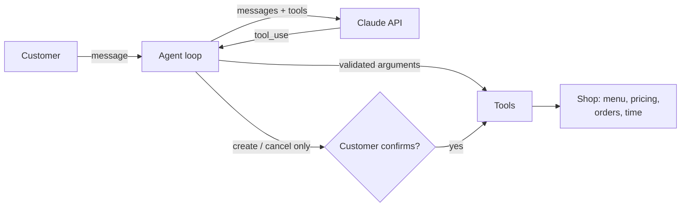

# Delivery Agent

A conversational AI agent that takes food-delivery orders. It is built on Claude tool use in Python,
and the shop behind it is plain, tested business logic.

Customers say things like *"two margherita pizzas to the city center, my name is Ana"* and the agent
finds the dishes, prices the order, asks for confirmation and places it, tracks it, or cancels it.

> The restaurants, menu, coupons and delivery zones are fictional demo data. This is a study project,
> not affiliated with any delivery company.

> **Status: work in progress.** The tools, the agent loop and the evaluation harness are done and
> covered by 100+ tests that run without an API key, including tests of the real Anthropic SDK
> against a mocked network. The first full evaluation run against Claude, with its results, is next.

## How it works



1. The agent sends the conversation and the tool definitions to Claude.
2. When Claude answers with `tool_use`, the agent validates the arguments, runs the tool against the
   shop and sends the result back, until Claude has a final answer.
3. A typical order is `search_menu` → `quote_order` → *(the customer confirms)* → `create_order`,
   and later `get_order_status` or `cancel_order`.

## Design decisions

Each one is covered by tests.

- **The model never sets a price.** Tools accept item ids and quantities only; any other argument is
  rejected. Totals are computed by the shop, and `create_order` re-prices the order itself.
- **Human confirmation is enforced in code** for the tools that change data (`create_order`,
  `cancel_order`), not only in the prompt. A prompt can be argued with; an `if` cannot.
- **Arguments are untrusted input.** Types, ranges, enums, unexpected keys and string lengths are
  validated in code before the shop is touched, even though the tool schemas already describe them.
- **Business rules live in `shop.py`,** with no AI and no HTTP: one restaurant per order, coupon
  minimums, cancellation only while the order is being received or prepared.
- **Money is integer cents,** never floats.
- **Time is injected,** so order statuses (received, preparing, on the way, delivered) are tested
  without waiting.
- **Failures are data.** A tool error goes back to the model as an `is_error` result so it can explain
  it or try something else. The loop is bounded, and refusals are handled explicitly.
- **Tests never call the API.** A scripted fake of the Claude client drives the agent loop, so the
  suite is fast, free and deterministic.
- **Data minimisation.** The agent asks only for a first name and a delivery zone: no phone, address
  or payment data.
- **The API key is never stored.** It comes from the environment or from a masked prompt, lives only in
  the running process, and is never written to disk or printed.

## Project layout

```
src/delivery_agent/
  shop.py       business rules: search, pricing, coupons, orders, statuses
  tools.py      tool definitions, argument validation, execution
  agent.py      the tool-use loop and its guardrails
  llm.py        the only place that builds Claude requests
  prompts.py    system prompt
  catalog.py    fictional menu, zones and coupons
  cli.py        terminal chat
tests/          unit tests, scripted fake of Claude
evals/          scenarios and the runner that scores the real model
```

## Run it (Windows, PowerShell)

```powershell
python -m venv .venv
.venv\Scripts\Activate.ps1
pip install -e ".[dev]"
pytest
```

To chat with it you need an Anthropic API key:

```powershell
$env:ANTHROPIC_API_KEY = "<your key>"
python -m delivery_agent
```

If `ANTHROPIC_API_KEY` is not set, the program asks for it with a masked prompt, checks that it looks like an Anthropic key, and keeps it in memory
for that run only.

Configuration comes from environment variables (see `.env.example`). The default model is
`claude-opus-5-5`; set `AGENT_MODEL` to use another one. If the API rejects the server-side refusal
fallback, set `ENABLE_FALLBACKS=0` (or pass `--no-fallbacks` to the evals).

## Evaluating the agent

`evals/scenarios.json` describes conversations and what must happen: which tools are called, with which
arguments, how many orders exist at the end, and what state an order is in. For example: a request
that mixes two restaurants must not create an order, and a request to cancel an order that is already
on the way must leave it untouched.

```powershell
python -m evals.run                  # every scenario
python -m evals.run --only coupon    # scenarios whose id contains "coupon"
python -m evals.run --model claude-haiku-5-5
```

It prints pass/fail per scenario, the tools the model chose, token usage and an estimated cost. A full
run is roughly one US dollar on the default model. The scoring code is itself tested offline, so a
failing scenario means the *model* did something unexpected, not the harness.

**Results:** not run yet. They will be added here after the first live run.
